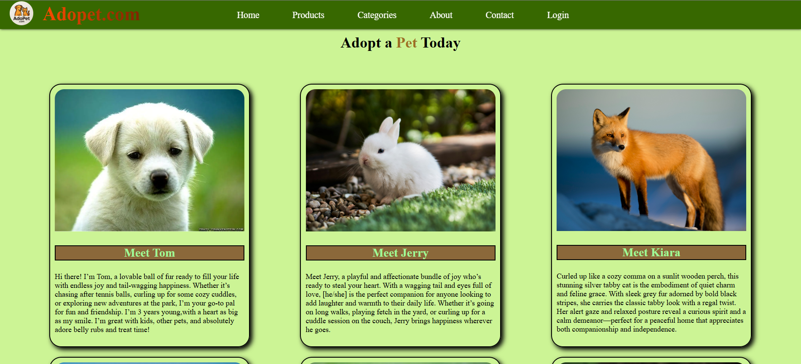

# 🐾 Adopet.com — Pet Adoption Website

A pet adoption website concept built using **HTML, CSS, and JavaScript**, designed to present pets through an attractive and easy-to-browse interface.

## 📸 Project Preview



## 📌 About the Project

Adopet.com is a frontend web development project focused on presenting pets available for adoption through visual profile cards.

The website features a navigation bar, pet images, names, and descriptions to create a welcoming browsing experience for visitors interested in pets.

## ✨ Features

- Pet profile cards with images and descriptions
- Navigation bar with Home, Products, Categories, About, Contact, and Login links
- Custom color scheme and styled layout
- Card-based pet presentation
- Frontend website design using HTML and CSS

## 🛠️ Technologies Used

- **HTML5** — Website structure
- **CSS3** — Styling and layout
- **JavaScript** — Frontend scripting

## 🚀 Getting Started

1. Clone this repository:

   ```bash
   git clone https://github.com/hemant-chandra/pet_adoption_page.git
   ```

2. Open the project folder:

   ```bash
   cd pet_adoption_page
   ```

3. Open `index.html` in your web browser.

## 📚 What I Learned

- Building a webpage using HTML
- Styling layouts and cards with CSS
- Organizing website content
- Creating a visual interface for a pet adoption concept
- Practicing frontend development fundamentals

## 🔮 Future Improvements

- Add search and filtering by animal type
- Add individual pet detail pages
- Implement adoption enquiry forms
- Improve mobile responsiveness
- Connect a backend for pet listings and adoption requests

## 👨‍💻 Author

**Hemant Chand**

GitHub: [hemant-chandra](https://github.com/hemant-chandra)

---

⭐ This project is part of my web development learning journey.
